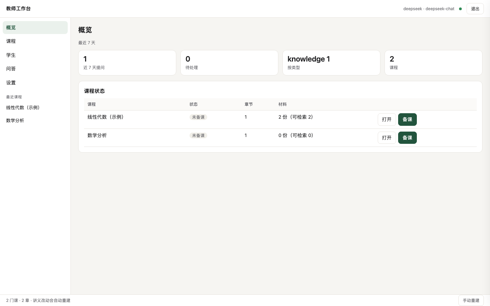
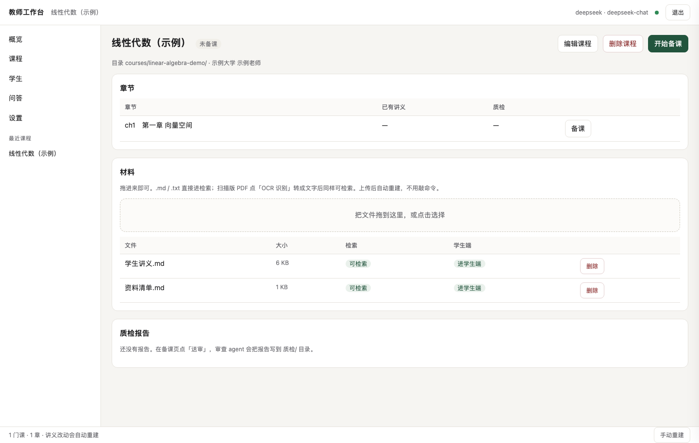
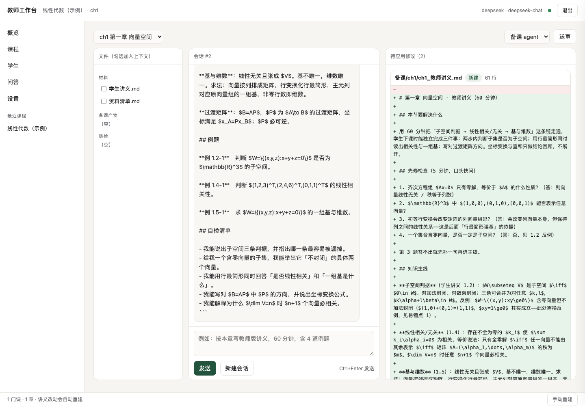

# 独立教师 AI 管理系统

给一对一 / 小班老师用的一套自助系统：**把课程材料变成知识库，让 AI 助教按你的讲法答疑，你在后台看学生到底卡在哪。**

不是「套壳 ChatGPT」：助教只能讲你讲义里的内容，每句话必须带出处，讲义改了它会自动失效重来。

- 零外部服务：本地向量模型 + 本地 SQLite，数据不出你的电脑
- 零前端构建：两个 HTML 文件，改完刷新就生效
- 有测试：98 项端到端自测，不需要 API key 也能跑

> **日常怎么用**看 [使用手册](docs/USAGE.md)，这份 README 讲的是为什么这么设计。
>
> **配置与分享**看 [配置指南](docs/配置指南.md)（[HTML 单文件版](docs/配置指南.html)，可直接发给别人）。
>
> 改完 Markdown 运行 `npm run docs` 重新生成 HTML。
>
> **对外介绍**看 [产品功能宣传页](docs/promo/产品功能宣传.html)（含演示视频与 14 张界面截图）。
> 注意：GitHub 不渲染 HTML，直接点开只会显示源码。想看到页面效果，用下面三种方式之一：
>
> 1. 本地双击 `docs/promo/产品功能宣传.html`
> 2. 开 GitHub Pages 后访问：`https://<用户名>.github.io/<仓库名>/promo/`
> 3. 用 `htmlpreview.github.io/?<文件链接>`
> 4. 或直接由本服务托管（不需要任何外部平台）：启动后访问 `http://127.0.0.1:8787/docs/promo/`

## 界面

| 概览 | 课程详情（材料上传） |
|---|---|
|  |  |

备课页：左列文件树（勾选加入上下文）、中间对话、右列文件与待应用修改的 diff。



## 它能做什么

| 能力 | 说明 |
| --- | --- |
| **课程知识库** | 讲义切块、黑名单隔离（教师版/答案物理上不进学生端）、页码与题号可追溯 |
| **学生自助答疑** | 每人一个访问码，打开网页就能问；回答带可点开的出处 |
| **按意图换讲法** | 判断学生在问概念、问题目、问某一步，还是问学习方法，用不同策略回答 |
| **额度控制** | 按人限每日/每月/累计/token，额度用完不再烧钱 |
| **教师后台** | 全部提问、待补答、按类型统计、学生码管理、学生画像 |
| **学生画像** | 每个学生一份 Markdown，老师手写；系统提供自动统计素材 |
| **教师工作台** | 一个界面完成建课、传材料、和 AI 备课、送审、看结论 |
| **课程库 / 学生库** | 课程可复用、学生独立建档；**一个学生可报多门课，一门课可带多名学生**（报名关系独立存储） |

## 快速开始

```bash
git clone <this-repo> teacher-ai && cd teacher-ai
npm install                 # 只有一个依赖：本地向量模型运行时
cp .env.example .env        # 不填 key 也能跑，会用 mock 模型

npm run build               # 讲义 → 知识包
npm run demo                # 起服务（demo 课，mock 模型）
```

教师工作台：`http://127.0.0.1:8787/teacher`（首次要输令牌，也可用 `/teacher?token=...` 直达）
学生答疑：`http://127.0.0.1:8787`（输入访问码）。令牌与码：

```bash
cat data/admin-token.txt    # 后台令牌
# 浏览器打开 http://127.0.0.1:8787/admin?token=<令牌>
# 后台 → 学生与访问码 → ＋ 新增学生 → 拿到访问码
```

想接真模型，填 `.env` 里的 `DEEPSEEK_API_KEY`（或任意 OpenAI 兼容端点）后重启，启动日志里会显示 `模型提供商：deepseek`。

> `npm run demo` 用 mock 模型时，答案是占位内容，只用于验证链路。填 key 后才是真实回答。

## 数据模型：课程库 × 学生库

接单不是"给学生建一门课"，而是三张表：

```
courses/<id>/            课程库：材料、备课产物、质检报告，可被反复复用
students/<目录>/         学生库：一人一份画像
enrollments              报名关系：学生 × 课程，多对多
```

所以：

- 同一个学生可以同时读数分和线代，**一个访问码管所有课**，学生端顶部切换课程
- 同一门课教第二个学生时，直接把新学生"加"到这门课，不用重做材料
- 学生只能问自己报过的课；问没报名的课程返回 403
- 额度**按单算**：同一门课可以给学生 20 次、另一门给 5 次；留空则跟随学生/课程默认
- 课程可编辑：改名、增删章节、把材料勾给某一章（决定哪份材料进哪章知识包）
- 质检报告写回 `质检/` 后，结论自动变成课程状态徽章（可授课 / 需修订 / 阻塞）

## 四个核心机制

### 1. 隔离做在构建期，不靠提示词

学生端能检索的文件由 `config/courses.json` 的白名单决定；`*备课*`、`*教师*`、`*答案*` 这类文件在**切块阶段就被拒绝**，根本不存在于知识包里。学生怎么套话都拿不到答案。

```
courses/<课程>/学生讲义.md        ← 唯一进学生端的材料
courses/<课程>/备课讲义.md        ← 命中黑名单，构建直接报错
```

### 2. 引用由程序校验，不由模型自觉

模型必须写 `[[块编号]]`，服务端逐条比对块编号是否真实存在于本次上下文。编造的编号会被删掉；一条有效引用都没有的回答会被标记为「未定位」，进教师待办。

### 3. 先判断意图，再决定怎么讲

| 学生问法 | 助教行为 |
| --- | --- |
| 什么是向量空间 / 为什么要求封闭 | 讲知识：概念、条件、反例，**不主动解题** |
| 这道题怎么做 / 直接贴题 | 讲题·引导：点考点、给第一步、反问，**不给答案** |
| 给我完整过程 | 讲题·完整：分步推导，每步标依据，最后给检验 |
| 这一步怎么来的 | 只讲这一步：只解释卡住的那一下，180 字内 |
| 这门课怎么复习 / 和后面什么联系 | 延伸拓展：讲义部分照常引用，延伸部分必须标「拓展（不在讲义原文）」 |

判断用规则优先（免费、可解释），拿不准才花约 100 tokens 让模型判一次。学生可以一键换讲法。

### 4. 额度按人算，用完不花钱

每天 / 每月 / 累计 / token / 每小时五个维度，`0` 表示不限。检查发生在**调用模型之前**，额度用完直接返回 429，不会产生费用。

## 检索：词法 + 向量

讲义切成块，两路并行检索后融合：

| 路子 | 原理 | 擅长 | 短板 |
| --- | --- | --- | --- |
| 词法 | 中文二元组倒排 + 标题加权 | 精确术语、题号、公式名 | 换个说法就丢 |
| 向量 | 本地 bge-small-zh（512 维，23MB，离线） | 同义改写、英文提问、口语 | 泛化标题会吸走查询 |

融合用 RRF（只看名次），权重默认 0.5/0.5，可用 `FUSION_VEC_WEIGHT` 调。

自带的 18 条探针（`npm run eval`）在 demo 课上的表现：

```
词法    Top1 44% | Top3 72% | 进注入集 83%
向量    Top1 61% | Top3 83% | 进注入集 100%
混合    Top1 50% | Top3 83% | 进注入集  94%
```

三个踩过的坑（都写进了代码注释）：

1. 文档侧只嵌「标题 + 正文前 600 字」——整块正文会稀释标题语义
2. 嵌入前洗掉 LaTeX 和 Markdown——公式符号对语义模型是纯噪声
3. 向量排序排除单元/章标题块——它们太泛，会把所有查询吸过去

**换语料后一定要重测**：`npm run eval`，别凭感觉调权重。

## 材料变更是自动生效的

不用记命令，也不用重启。`npm run watch` 会监听 `courses/`：

- 你存盘 → 重建知识包（毫秒级）→ **只给改过的章节重算向量**（约 0.4 秒）
- 服务端按文件 mtime 热加载，学生下一次提问就用到新内容
- 构建产物（`助教/知识包清单.md`）被排除在监听之外，不会自己触发自己

`scripts/start.sh` 会把监听器和服务器一起拉起来，Ctrl+C 一起停。纯命令行等价：

```bash
npm run build && npm run build:vectors -- --only-stale
```

如果只重建了知识包、忘了向量，系统不会用错——版本号对不上时该章自动退回纯词法，`/healthz` 的 `retrieval.chapters` 会少一章，能直接看出来。

## 目录

```
.
├── config/courses.json      课程、白名单/黑名单、回答策略、额度默认值
├── courses/<课程>/          课程材料（讲义、资料清单、勘误）
│   └── 助教/                构建产物：知识包清单
├── students/<学生>/         学生画像（Markdown，老师手写）
├── src/
│   ├── pack.js              切块、黑名单、词法排序、预算装配
│   ├── embed.js             本地向量模型 + 文本清洗
│   ├── search.js            词法 + 向量 RRF 融合
│   ├── intent.js            意图判断（5 类）
│   ├── answer.js            5 套提示词、引用校验、HTML 渲染
│   ├── quota.js             额度计算（纯函数，可测）
│   ├── students.js          学生码：种子 + 数据库 + 明文流水
│   ├── profile.js           学生画像：读写 Markdown + 自动摘要
│   ├── store.js             SQLite 留痕
│   └── server.js            HTTP 服务 + 两个页面
├── scripts/                 构建、体检、评测、发码、隧道
└── test/smoke.mjs           98 项端到端自测
```

## 部署

**本机 + 临时隧道**（最快，适合试点）：

```bash
./scripts/start.sh     # 起服务，防休眠
./scripts/tunnel.sh    # 另开终端，拿公网链接
```

**长期在线**：放到一台 VPS 上，`node src/server.js` 即可，前面挂个 Nginx 或直接用隧道。没有数据库服务要装，SQLite 是文件。

**注意**：如果开了 TUN / 全局代理，Cloudflare 隧道会连不上（它的 7844 端口会被虚拟网卡抢走）。关掉 TUN 再起隧道。

## 隐私

- 学生提问、画像、访问码都只写本地磁盘，不上传任何第三方（除了你自己选的模型 API）
- 模型调用只发送：讲义摘录 + 学生这一条提问。不发学生姓名、历史对话
- 访问码只存 SHA-256，明文只在你生成时显示一次
- `.gitignore` 已排除 `.env`、`data/`、`packs/`，不会误提交

**你仍然需要自己把控**：学生姓名属于个人信息，公开仓库前检查 `students/` 与 `courses/` 里有没有真实人名。

## 已知限制

- 没有跨会话记忆：每个问题独立回答，避免把不同题目的条件串起来
- 单进程 SQLite：适合一位老师几十个学生，不适合全校并发
- 额度用量只增不减：想「清零」只能改数据库，防止误点抹掉真实成本
- 向量模型是 small 版：换 `bge-base-zh` 能再涨几个点，代价是体积和首次加载变慢

## License

MIT，见 [LICENSE](LICENSE)。

## 第三方资源

`src/web/vendor/katex/` 是 [KaTeX](https://katex.org/) 0.16.11 的构建产物（MIT License），
本地托管是为了让公式渲染不依赖 CDN——学生手机在国内访问 jsdelivr 经常失败，那时会退化成原始 LaTeX 文本。

# 制作不易，如果您觉得有帮助，欢迎大家打赏
丰俭由人，如果各位老板高兴，请作者喝杯咖啡就行！祝大家生活愉快，工作顺利😀


